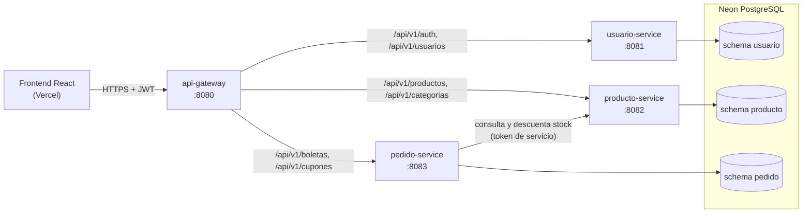
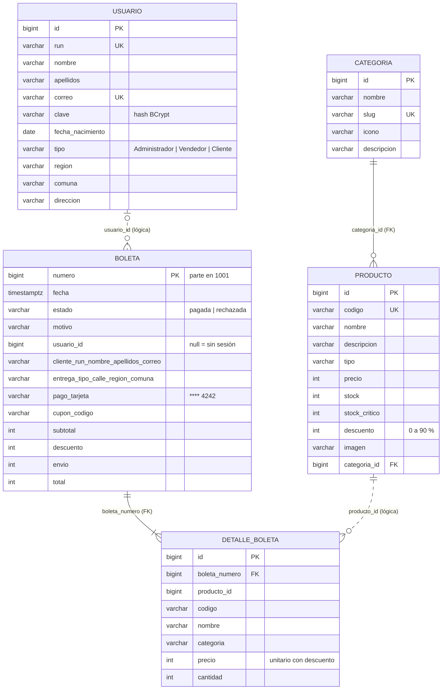

# NexusTech · Backend

Backend de la tienda **NexusTech**: 4 microservicios en **Spring Boot (Java 21, Maven)**. Cada servicio usa su propio *schema* en una base **PostgreSQL (Neon)**.

- Frontend (React + Vite): <https://github.com/CristobalStenger/nexus_frontend>
- Nube: Google Cloud Run (backend), Neon (base de datos) y Vercel (frontend)

## Arquitectura



| Servicio | Puerto local | Schema / rol de BD | Responsabilidad |
|---|---|---|---|
| `api-gateway` | 8080 | — | Punto de entrada único. Hace el ruteo, el CORS y la primera validación del JWT, y reúne el Swagger de todos los servicios. |
| `usuario-service` | 8081 | `usuario` / `usuario_app` | Usuarios, registro, login y emisión del JWT. |
| `producto-service` | 8082 | `producto` / `producto_app` | Catálogo (productos y categorías) y stock. |
| `pedido-service` | 8083 | `pedido` / `pedido_app` | Checkout, boletas y cupones. |

### Tecnologías

| Para qué | Tecnología |
|---|---|
| Base del proyecto | Java 21, Spring Boot 4.1.3, Maven (cada servicio trae su wrapper `./mvnw`) |
| API Gateway | Spring Cloud Gateway (Spring Cloud 2025.1) |
| Seguridad | Spring Security, con JWT firmado con HS256 (OAuth2 Resource Server + Nimbus) y contraseñas cifradas con BCrypt |
| Acceso a datos | Spring Data JPA (Hibernate 7) y PostgreSQL |
| Migraciones | Flyway |
| Documentación de la API | springdoc-openapi 3 (Swagger UI) |
| Pruebas | JUnit 5, Mockito, MockMvc y spring-security-test |
| Utilidades | Lombok |

## Modelo de datos

Son las 5 tablas de la propuesta (USUARIO, BOLETA, DETALLE_BOLETA, PRODUCTO y CATEGORIA), repartidas en un schema por servicio:



- **Un schema y un rol por servicio.** `producto_app` no puede leer el schema `usuario`, y lo mismo vale para los otros roles. Ningún servicio toca los datos de otro.
- **Relaciones entre servicios sin FOREIGN KEY.** `boleta.usuario_id` y `detalle_boleta.producto_id` apuntan a otros schemas, así que la relación es lógica. Por eso la boleta guarda una **copia** del cliente y de cada producto al momento de la compra. Si después cambia el precio o se elimina el producto, la boleta no cambia.
- **Flyway crea las tablas** al arrancar cada servicio, con los scripts de `src/main/resources/db/migration`. `V1` crea las tablas y `V2` carga los datos iniciales del frontend: 4 categorías, 40 productos, 3 usuarios y 5 boletas. Hibernate solo comprueba que las entidades calcen con las tablas (`ddl-auto: validate`).

## Roles y permisos

| | Público | Cliente | Vendedor | Administrador |
|---|:-:|:-:|:-:|:-:|
| Ver productos y categorías | ✅ | ✅ | ✅ | ✅ |
| Comprar (checkout) y validar cupones | ✅ | ✅ | ✅ | ✅ |
| Ver y editar su propio perfil (`/usuarios/me`) | — | ✅ | ✅ | ✅ |
| Ver órdenes (lista y detalle) | — | — | ✅ | ✅ |
| Crear, editar y eliminar productos y categorías | — | — | — | ✅ |
| Gestionar usuarios | — | — | — | ✅ |

El registro desde la tienda crea siempre un **Cliente**. Nadie puede cambiar su propio rol ni eliminar su propia cuenta.

## Endpoints (API v1)

Todas las rutas pasan por el gateway: `http://localhost:8080` en local, o la URL de Cloud Run.
Swagger unificado: **`/swagger-ui.html`** (se elige el servicio arriba a la derecha y el token se pega en **Authorize**).

| Método | Ruta | Acceso | Descripción |
|---|---|---|---|
| POST | `/api/v1/auth/login` | Público | Recibe `{correo, clave}` y devuelve `{token, usuario}`. |
| POST | `/api/v1/auth/registro` | Público | Crea una cuenta de Cliente. |
| GET / PUT | `/api/v1/usuarios/me` | Con sesión | Muestra o edita el propio perfil (sin cambiar el rol). |
| GET / POST | `/api/v1/usuarios` | Administrador | Lista o crea usuarios. |
| GET / PUT / DELETE | `/api/v1/usuarios/{id}` | Administrador | Detalle, edición (contraseña vacía = se mantiene) o eliminación. |
| GET | `/api/v1/productos` | Público | Catálogo. Con `?ids=1&ids=2` devuelve solo esos productos. |
| GET | `/api/v1/productos/{id}` | Público | Detalle de un producto. |
| POST / PUT / DELETE | `/api/v1/productos[/{id}]` | Administrador | CRUD de productos. |
| GET | `/api/v1/categorias[/{id}]` | Público | Categorías. |
| POST / PUT / DELETE | `/api/v1/categorias[/{id}]` | Administrador | CRUD de categorías. No elimina una categoría con productos (409). |
| POST | `/api/v1/productos/stock/descontar` · `/reponer` | Solo pedido-service | Uso interno; el gateway lo bloquea desde afuera. |
| POST | `/api/v1/boletas` | Público (con o sin sesión) | Checkout: devuelve la boleta con estado `pagada` o `rechazada`. |
| GET | `/api/v1/boletas[/{numero}]` | Vendedor y Administrador | Lista (de la más nueva a la más antigua) o detalle. |
| GET | `/api/v1/cupones/{codigo}` | Público | Valida un cupón: FELIZ18, CUTURRUFO70, BOOTSTRAP, XAVICRIS. |

**Errores.** Siempre vienen en JSON (RFC 7807). Los de validación incluyen el mensaje de cada campo para mostrarlo en el formulario:

```json
{ "status": 400, "title": "Bad Request", "detail": "Revisa los datos enviados.",
  "errores": { "precio": "El precio no puede ser negativo.", "codigo": "El código es obligatorio." } }
```

**Ejemplo de checkout** (`POST /api/v1/boletas`). Los precios **no** vienen del navegador: el backend los consulta en producto-service.

```json
{
  "cliente": { "nombre": "Pedro", "apellidos": "Soto Fuentes", "correo": "cliente@gmail.com" },
  "entrega": { "tipo": "despacho", "calle": "Los Crisantemos 789", "departamento": "603",
               "region": "Región Metropolitana", "comuna": "Providencia", "indicaciones": "" },
  "items": [ { "productoId": 1, "cantidad": 2 } ],
  "cupon": "FELIZ18",
  "pago": { "numeroTarjeta": "4242 4242 4242 4242", "titular": "Pedro Soto", "vencimiento": "12/30", "cvv": "123" }
}
```

Reglas del checkout (las mismas que tiene hoy el frontend):
- Precio final de cada producto = `precio × (1 − descuento/100)`, redondeado.
- El cupón descuenta un % del subtotal, el despacho cuesta $3.990 y el retiro en tienda es gratis.
- Si no alcanza el stock, la boleta queda `rechazada` y el stock no se toca.
- Las tarjetas terminadas en `0000` también quedan `rechazada`, sin tocar el stock.
- Si se paga, pedido-service descuenta el stock en producto-service: todos los productos o ninguno. Si la boleta no se puede guardar, devuelve el stock (compensación).
- De la tarjeta solo se guardan los últimos 4 dígitos.

## Seguridad: cómo viaja el JWT

1. `POST /api/v1/auth/login`: usuario-service revisa la contraseña con BCrypt y firma un JWT con HS256. El token incluye `sub` (id del usuario), `rol`, `run` y `correo`, y dura 120 minutos.
2. El frontend envía `Authorization: Bearer <token>` en cada petición.
3. El **api-gateway** rechaza con 401 un token falso o vencido, aplica el CORS (solo el dominio del frontend) y bloquea `/stock`.
4. **Cada microservicio vuelve a validar** el token con el mismo secreto (`JWT_SECRET`) y aplica los permisos del rol. El claim `rol` se convierte en `ROLE_<rol>`. La validación se repite porque las URLs de los servicios en Cloud Run también son públicas.
5. Para mover stock, pedido-service firma su propio token corto con rol `SERVICIO`. Así un cliente no puede descontar stock con su token.

## Ejecutar en local

**Requisitos:** JDK 21 y PostgreSQL. No hace falta instalar Maven: cada servicio trae `./mvnw` (`mvnw.cmd` en Windows). También se puede usar una rama de Neon en vez de un PostgreSQL local.

1. Crea la base y prepara los schemas. Ambos comandos piden la contraseña del usuario
   `postgres`; en Windows también puedes crear la base `nexus` en pgAdmin y ejecutar ahí
   `db/crear-schemas.sql` con el Query Tool.
   ```bash
   createdb -h localhost -U postgres nexus
   ```
   ```bash
   psql -h localhost -U postgres -d nexus -f db/crear-schemas.sql
   ```
2. En cada servicio, copia `.env.example` a `.env` (el `.env` no se sube a GitHub). Los valores
   de ejemplo ya calzan con `db/crear-schemas.sql`, así que en local funcionan sin cambios:
   ```bash
   for s in usuario-service producto-service pedido-service api-gateway; do cp $s/.env.example $s/.env; done
   ```
   Para usar Neon cambia `DB_URL` y las contraseñas. El `JWT_SECRET` debe ser el **mismo en los
   4 servicios** y tener al menos 32 caracteres.
3. Levanta los servicios, cada uno en su propia terminal, en este orden: usuario, producto, pedido y gateway.
   ```bash
   cd usuario-service && ./mvnw spring-boot:run
   ```
4. Prueba:
   - Swagger: <http://localhost:8080/swagger-ui.html>
   - Prueba completa de la API: `./scripts/prueba-api.sh` (ver más abajo).
5. Frontend ([`nexus_frontend`](https://github.com/CristobalStenger/nexus_frontend)): en
   `nexustech-react`, `npm ci` y `npm run dev`. Por defecto llama al gateway en
   `http://localhost:8080` (variable `VITE_API_URL`), y el gateway acepta los orígenes de Vite
   `http://localhost:5173` y `http://localhost:4173` (variable `FRONTEND_URL`).

**Usuarios de prueba**

| Rol | Correo | Contraseña |
|---|---|---|
| Administrador | `admin@duoc.cl` | `admin123` |
| Vendedor | `vendedor@duoc.cl` | `vende123` |
| Cliente | `cliente@gmail.com` | `cliente123` |

## Pruebas

- **Unitarias y de seguridad** (`./mvnw test` en cada servicio, 48 en total). No necesitan base de datos. Cubren:
  - Lógica de negocio con Mockito: cálculo de totales, cupones, rechazos, compensación de stock, RUN con dígito verificador, BCrypt, contenido del JWT, slugs y validaciones.
  - Permisos por rol con MockMvc.
  - CORS y JWT en el gateway.
- **De punta a punta** (`./scripts/prueba-api.sh [URL_GATEWAY]`). Recorre unos 30 casos contra los servicios encendidos, pasando por el gateway:
  - endpoints públicos;
  - login;
  - 401 y 403 por rol;
  - CRUD;
  - registro;
  - compra pagada y rechazada.

  Sirve igual contra la URL de Cloud Run. Ojo: registra 2 boletas de prueba y descuenta 1 unidad de stock del producto 1.

## Despliegue en la nube

### 1. Base de datos en Neon
1. Crea un proyecto en <https://neon.tech> con PostgreSQL 17, en la región **AWS São Paulo (sa-east-1)**. Si no está disponible, usa `us-east-1` y despliega Cloud Run en `us-east1`: lo importante es que la base y los servicios queden cerca.
2. En el **SQL Editor** ejecuta `db/crear-schemas.sql`, reemplazando las 3 contraseñas por claves largas y aleatorias.
3. Copia el host de la conexión **directa** (el que **no** termina en `-pooler`). Flyway usa *locks* de sesión que no funcionan con el *pooler*.
   ```
   DB_URL=jdbc:postgresql://ep-xxxx.sa-east-1.aws.neon.tech/neondb?sslmode=require
   ```

### 2. Backend en Google Cloud Run
Lo primero, en la consola de Google Cloud:
- Crea el proyecto y asócialo a una cuenta de facturación.
- Crea una **alerta de presupuesto** de 5–10 USD en *Facturación → Presupuestos y alertas*.

Después, desde la carpeta del repositorio, con [gcloud](https://cloud.google.com/sdk/docs/install) instalado:

```bash
gcloud init
```

```bash
gcloud config set run/region southamerica-east1
```

```bash
gcloud services enable run.googleapis.com cloudbuild.googleapis.com artifactregistry.googleapis.com secretmanager.googleapis.com
```

Secretos. El del JWT se genera al azar (64 caracteres; con menos de 32 los servicios no arrancan):

```bash
openssl rand -base64 48 | tr -d '\n' | gcloud secrets create jwt-secret --data-file=-
```

Las 3 contraseñas de Neon: cada comando pide el valor y lo lee sin mostrarlo.

```bash
for s in db-pass-usuario db-pass-producto db-pass-pedido; do read -rsp "$s: " v; echo; printf '%s' "$v" | gcloud secrets create $s --data-file=-; done
```

Permisos para la cuenta de servicio con la que corren y se construyen los servicios (leer secretos y compilar desde el código):

```bash
CUENTA="$(gcloud projects describe $(gcloud config get-value project) --format='value(projectNumber)')-compute@developer.gserviceaccount.com"
for rol in roles/secretmanager.secretAccessor roles/run.builder; do gcloud projects add-iam-policy-binding $(gcloud config get-value project) --member="serviceAccount:$CUENTA" --role=$rol --condition=None; done
```

Despliegue de los 4 servicios. Cloud Run compila cada carpeta con Maven, sin Dockerfile. `DB_URL` es la URL de Neon del paso 1. La primera vez, gcloud pregunta si crea el repositorio de Artifact Registry donde guarda las imágenes: responde que sí.

```bash
DB_URL='jdbc:postgresql://ep-xxxx.sa-east-1.aws.neon.tech/neondb?sslmode=require'
COMUNES="--allow-unauthenticated --memory 1Gi --cpu-boost --max-instances 2"
```

```bash
gcloud run deploy producto-service --source producto-service $COMUNES \
  --set-env-vars "DB_URL=$DB_URL,DB_USER=producto_app" \
  --set-secrets "DB_PASSWORD=db-pass-producto:latest,JWT_SECRET=jwt-secret:latest"
```

```bash
gcloud run deploy usuario-service --source usuario-service $COMUNES \
  --set-env-vars "DB_URL=$DB_URL,DB_USER=usuario_app" \
  --set-secrets "DB_PASSWORD=db-pass-usuario:latest,JWT_SECRET=jwt-secret:latest"
```

```bash
PRODUCTO_URL=$(gcloud run services describe producto-service --format='value(status.url)')
gcloud run deploy pedido-service --source pedido-service $COMUNES \
  --set-env-vars "DB_URL=$DB_URL,DB_USER=pedido_app,PRODUCTO_URL=$PRODUCTO_URL" \
  --set-secrets "DB_PASSWORD=db-pass-pedido:latest,JWT_SECRET=jwt-secret:latest"
```

```bash
USUARIO_URL=$(gcloud run services describe usuario-service --format='value(status.url)')
PEDIDO_URL=$(gcloud run services describe pedido-service --format='value(status.url)')
gcloud run deploy api-gateway --source api-gateway $COMUNES \
  --set-env-vars "USUARIO_URL=$USUARIO_URL,PRODUCTO_URL=$PRODUCTO_URL,PEDIDO_URL=$PEDIDO_URL,FRONTEND_URL=http://localhost:5173" \
  --set-secrets "JWT_SECRET=jwt-secret:latest"
```

Comprueba que todo responde:

```bash
./scripts/prueba-api.sh $(gcloud run services describe api-gateway --format='value(status.url)')
```

**Arranque en frío.** Con 0 instancias mínimas (gratis), un servicio sin uso se apaga y tarda unos segundos en despertar. Si el gateway despierta y llama a un servicio que también duerme, las esperas se suman. Para la presentación conviene dejar 1 instancia encendida en cada servicio y volver a 0 después, porque mantener instancias encendidas tiene costo:

```bash
for s in api-gateway usuario-service producto-service pedido-service; do gcloud run services update $s --min-instances 1; done
```

### 3. Frontend en Vercel
- Importa el repositorio `nexus_frontend` con **Root Directory** `nexustech-react`. Vite se detecta solo y el repositorio ya trae `vercel.json` (todas las rutas responden `index.html`).
- Define la variable `VITE_API_URL` con la URL del api-gateway. Se lee al compilar, así que si cambia hay que volver a desplegar.
- Autoriza el dominio de Vercel en el CORS del gateway (solo el dominio de producción; las URL de vista previa de Vercel quedan bloqueadas). Si son varios orígenes, van separados por coma (el `^@^` le indica a gcloud que no corte en las comas):
  ```bash
  gcloud run services update api-gateway --update-env-vars "^@^FRONTEND_URL=https://tu-app.vercel.app"
  ```

### 4. Antes de abrir el sitio
- [ ] `./scripts/prueba-api.sh` contra la URL del gateway termina en "Todo OK".
- [ ] El frontend en Vercel carga el catálogo y permite iniciar sesión (si dice "No se pudo conectar", revisa `VITE_API_URL` y `FRONTEND_URL`).
- [ ] `FRONTEND_URL` tiene solo el dominio de Vercel (sin `localhost`).
- [ ] Alerta de presupuesto creada e instancias mínimas en 0 fuera de la presentación.
- [ ] Después de la evaluación, cambia la contraseña de `admin@duoc.cl` desde *Mi perfil*: `admin123` está publicada en este README y en la pantalla de login.

## Estructura del repositorio

```
nexus_backend/
├── db/crear-schemas.sql        # schemas y roles (se ejecuta una vez en Neon)
├── scripts/prueba-api.sh       # prueba de punta a punta vía gateway
├── api-gateway/                # Spring Cloud Gateway (WebFlux)
├── usuario-service/            # cada servicio:
├── producto-service/           #   config/      seguridad, Swagger, errores
└── pedido-service/             #   controller/  REST /api/v1/...
                                #   service/     lógica de negocio
                                #   repository/  Spring Data JPA
                                #   model/       entidades
                                #   dto/         datos de entrada validados
                                #   resources/db/migration  Flyway
```
